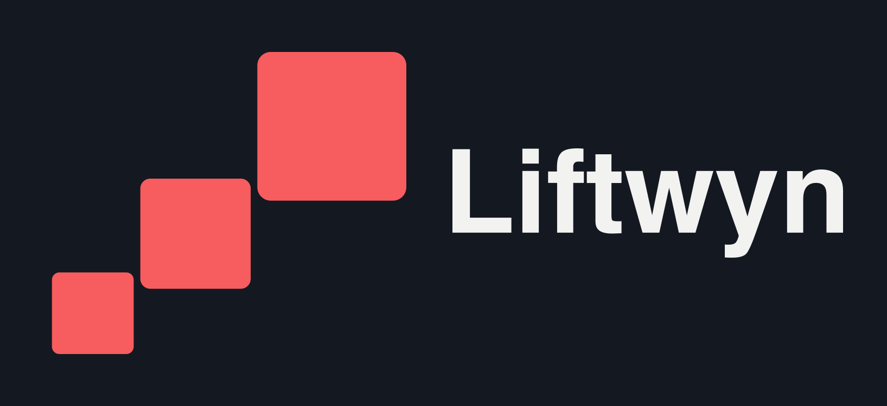

# Liftwyn branding

- Light logo: [Transparent PNG](logo/liftwyn-logo.png) · [SVG](logo/liftwyn-logo.svg)
- Dark logo: [Transparent PNG](logo/liftwyn-logo-dark.png) · [SVG](logo/liftwyn-logo-dark.svg)
- [Light preview](logo/preview-light.png): background `#F6F6F6`.

Both logo variants use three ascending coral (`#F75C5F`) squares beside Liftwyn lettering. The light logo uses gray (`#636363`) lettering; the dark logo uses off-white (`#F2F2F0`). The dark preview uses a charcoal (`#141821`) background.

PNGs, SVGs, and previews share a 1635 × 750 presentation. Both logo variants have transparent backgrounds. SVG lettering uses vector paths with no embedded images, raster filters, or font dependencies. Both variants share the same geometry; only the lettering fill color differs.
